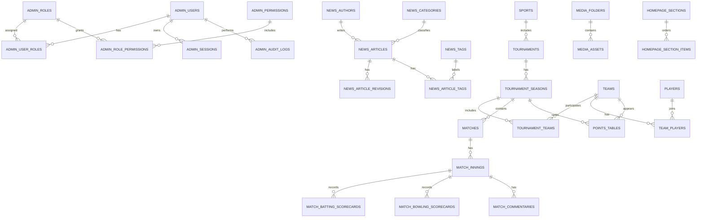

# Proposed platform architecture and security boundaries

This is a design for review, not executable code or a declaration of production readiness. The backend and admin repositories were not accessible for inspection. Their existing schemas, dependencies and conventions may require changes to this proposal.

## System boundaries

```text
Public browser ── same-origin Next.js public website ── read-only API ─┐
Admin browser  ── same-origin Next.js admin BFF/proxy ── admin/auth API ├─ Spring Boot modular monolith ─ PostgreSQL
                                                                       └─ media storage abstraction (files outside DB)
```

Deploy three independently versioned projects: existing `sports-web`, `sports-web-admin-panel`, and `sports-web-backend`. The public frontend performs server-side reads for SEO; browser traffic goes through relative paths and a carefully scoped server proxy, never browser `localhost`. The admin proxy forwards only allowed backend paths, cookies and CSRF headers, not arbitrary user-supplied URLs. The database is reachable only from the backend. Local dev can run on 3000/3001/8080 with PostgreSQL on 5432; this environment currently lacks Java, Maven, PostgreSQL and Docker, so those services were not run.

### Cookie/auth deployment decision — resolve before implementation

A single site under same-origin reverse proxy paths is the simplest choice for cookies and CSRF. If admin and API use distinct origins/sites, explicitly decide hostnames, CORS exact origin allowlist, cookie scope, SameSite, Secure/TLS and proxy trust. Do not use wildcard CORS with credentials. Backend issues short-lived access JWTs and opaque, high-entropy refresh tokens in HttpOnly, Secure, appropriately SameSite cookies; store only refresh-token hashes with expiry, user, device/session, rotation family and revocation state. Rotate atomically, invalidate a family on replay, revoke on logout, password change and account deactivation; do not put tokens in localStorage. Use CSRF protection on every cookie-authenticated state-changing request, including login, refresh and logout, plus origin checks. JWT verification must pin algorithms, validate issuer/audience/expiry, use external secrets/keys, and check user status and permissions server-side. Role/permission changes must take effect promptly, e.g. via session/security version checked server-side rather than trusting stale token claims. Use framework-supported implementations with dedicated integration tests; these points are design requirements, not implemented guarantees.

Failed login counters and lockout must be atomic and keyed to an account without allowing user enumeration; add distributed, shared-store throttling in production and a generic response. Provide an audited, expiring one-time bootstrap flow via environment/injected secret, not a shipped credential; force initial password change. Forgot-password returns generic responses and uses expiring, one-use hashed tokens and a configured mail delivery mechanism. No public admin registration. Protect last active super administrator with transactional invariants.

## Conceptual PostgreSQL model

Use Flyway-only migrations, JPA `ddl-auto=validate`, UTC timestamps, immutable primary IDs, unique slugs where public, foreign keys, appropriately scoped indexes, and least-privilege DB roles. Soft deletion is a deliberate, module-specific policy, not a substitute for audit or permission checks. Avoid reserved identifiers and ambiguous `status` names. The relationships below are proposed, not migrations.



Additional required tables: `admin_login_history`, `admin_refresh_tokens` (or a clearly mapped `admin_sessions` model), `sports`, `countries`, `match_fall_of_wickets`, `match_partnerships`, `match_officials`, `fixtures` (avoid duplicating schedule truth; choose a single ownership model), `video_categories`, `video_tags`, video tag/media associations, `news_article_media`, `site_settings`, `navigation_menus`, `navigation_items`, `seo_settings`, `redirects`. Define the relevant ownership, reference and retention policies before writing DDL. For homepage references, prefer typed association tables or checked typed references over unchecked polymorphic IDs. Store editorial source and a sanitized renderable representation or use structured blocks; validate and sanitize server-side with an allowlist, and never inject arbitrary HTML into Next.js.

Publication eligibility must be enforced in the database query/service for **every** public list, detail, search, sitemap, homepage and related-content lookup: status `PUBLISHED`, not deleted, `published_at <= now`, visibility and authorization respected. Scheduling is a transactional, audited transition, not merely a front-end date check. Draft/revision storage and preview must be authenticated and never cached publicly. Write endpoints enforce a transition matrix and distinct create/edit/review/publish permissions, ownership rules, optimistic locking and audit events. Invalidate affected pages and sitemap on publish/unpublish/update using a signed server-to-server revalidation mechanism with bounded TTL as fallback.

## Live-score invariants

Model a ball as an integer legal-ball count and typed runs/extras/wicket information, not floating-point overs; support formats with rules specific to the sport/competition. All updates to an innings, player figures, partnerships, falls of wicket, commentary and event history must be atomic. Use row locking or optimistic concurrency with a version, idempotency keys for retries, permission checks and append-only audited events/corrections. Validate the active innings, participants, striker, bowler, team membership, allowed state transitions and cricket rules, including legal/non-legal deliveries; define penalty runs and corrections explicitly. Never apply a score mutation from client-supplied totals without validation. Future WebSocket delivery should follow committed events, not introduce a second source of truth.

## Media, APIs, and observability

- Authenticated, permission-checked uploads: limit size, inspect magic bytes and decoded image dimensions, restrict types, generate storage names, prevent path traversal, strip dangerous metadata where appropriate, scan as configured, serve with safe content type and no executable interpretation. Keep files outside the app and DB; define public/private access, lifecycle, orphan cleanup and reference-protected deletion. Treat SVG as untrusted and reject or sanitize. Do not expose filesystem paths.
- Versioned API `/api/v1/public`, `/api/v1/admin`, `/api/v1/auth`: request/response DTOs, validation, stable error codes, request IDs, pagination with bounded page size and allowlisted sorting. Never leak stack traces, passwords, token hashes or private drafts. Public and admin projections must be separate. OpenAPI must describe permissions and errors. Proposed shape: `{success,message,data,timestamp}`; pagination belongs inside `data` and includes `content,page,size,totalElements,totalPages`.
- Structured security/audit logs should record actor, action, target, time, correlation ID and safe before/after summaries; exclude passwords, tokens, cookies and private article bodies where unnecessary. Configure retention, access, backups, alerting and monitoring separately for production.
- Production configuration must fail closed if DB credentials, JWT keys, allowed origins, storage or publication policies are missing. Separate local/UAT/prod environment settings and never commit secrets. Deployment must set CSP/frame-ancestor policy and other headers consistent with actual origins.

## Acceptance testing before rollout

Use PostgreSQL Testcontainers (not H2-only) for migrations and concurrent-write tests; backend service/controller/security tests for login/lockout, refresh replay, CSRF, roles, last-super-admin, all publication paths, scheduling, score invariants, uploads and audit. Add admin component and permission tests, public API-contract and metadata/sitemap tests, plus browser smoke tests for public/admin mobile and desktop. Test draft non-disclosure across detail, list, search, sitemap, homepage and caches. CI should run migrations from empty and upgrade from previous schema. Confirm domain, TLS, cookie behavior, rate limiting, media access, recovery and backup procedures in the actual deployment environment. No acceptance gate is met solely by this proposal.
